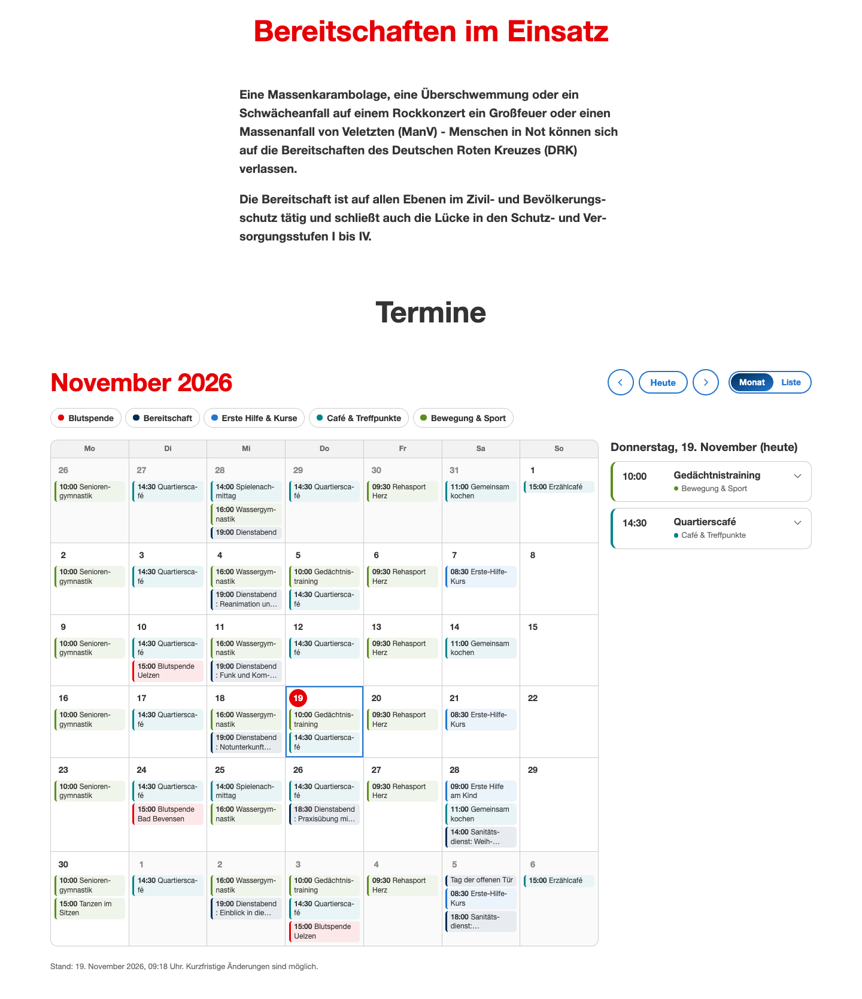
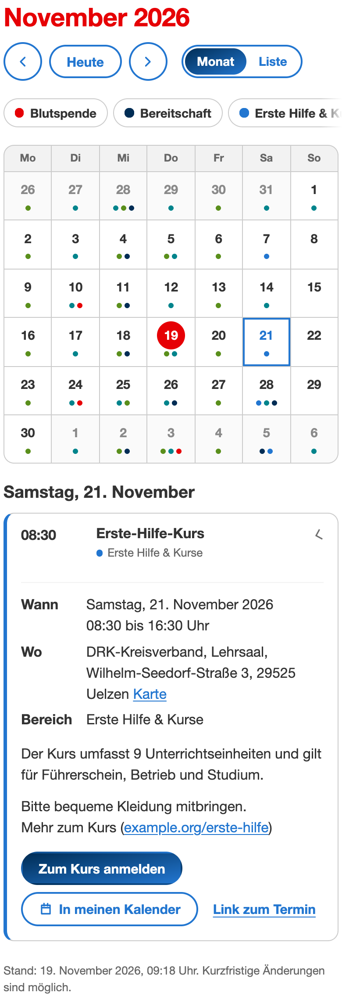

# DRK-Kalender

Monatskalender für DRK-Termine im Stil von [drk-uelzen.de](https://www.drk-uelzen.de), gebaut aus
mehreren iCal-Kalendern (Bereitschaft, Café, Sport, Blutspende, Kurse …) als statische Seite.
Er wird per iframe in die Vereinsseite eingebunden und passt sich an Smartphone und Desktop an.

**Teils noch Beispieldaten.** Die Bereitschaft kommt live aus dem HiOrg-Server (Kalender-Abo als
JSON). Blutspende, Kurse, Café und Sport sind noch ausgedachte Termine aus `samples/`; die Pipeline
dahinter ist dieselbe.

| Eingebettet (Desktop) | Smartphone |
|---|---|
|  |  |

## Was der Kalender kann

- Monatsraster mit Terminen je Tag; auf schmalen Bildschirmen Punkte statt Einträge
- Tagesliste mit aufklappbaren Details: Zeit, Ort mit Kartenlink, Beschreibung, Bereich
- Knöpfe „In meinen Kalender“ (.ics je Termin), „Link zum Termin“ (Direktlink `#termin/…`)
  und, falls eingerichtet, ein Anmeldeknopf
- Filter je Kalender, Ansicht „Monat“ oder „Liste“, Tastatursteuerung im Raster (Pfeiltasten, Bild auf/ab)
- iCal-Besonderheiten: Serien (RRULE), Ausnahmen (EXDATE), verschobene oder abgesagte Einzeltermine
  (RECURRENCE-ID, STATUS:CANCELLED), ganz- und mehrtägige Termine, Zeitumstellung, Outlook-Zeitzonen,
  HTML in Google-Beschreibungen, gleiche Termine in mehreren Kalendern

## So funktioniert es

```
calendars.json ──▶ npm run build ──▶ dist/ ──▶ GitHub Pages ──▶ iframe auf drk-uelzen.de
 (Kalender-URLs)    lädt alle Feeds,   index.html, events.json,
                    löst Serien auf    ics/*.ics, embed.js
```

Eine GitHub Action baut die Seite bei jedem Push und **stündlich** neu. Kann ein Kalender nicht
geladen werden, bricht der Build ab und die letzte Version bleibt online – lieber ein paar Stunden
alt als plötzlich leer.

Angezeigt werden zwei Monate zurück und zwölf voraus (`window` in `calendars.json`).
Alle Zeiten sind deutsche Zeit, egal wo der Build läuft.

## Kalender eintragen

`calendars.json`, ein Eintrag je Kalender, Reihenfolge = Reihenfolge der Filter:

```json
{
  "title": "Termine im DRK-Kreisverband Uelzen",
  "window": { "monthsBack": 2, "monthsAhead": 12 },
  "calendars": [
    { "id": "cafe", "name": "Café & Treffpunkte", "color": "#00848c",
      "url": "https://cloud.example.org/remote.php/dav/public-calendars/abc?export" },
    { "id": "bereitschaft", "name": "Bereitschaft", "color": "#002d55",
      "urlEnv": "CAL_URL_BEREITSCHAFT",
      "registration": { "type": "event-url", "label": "Zum Dienst melden" } }
  ]
}
```

Quelle, genau eine davon:

- `url`: öffentliche iCal-Adresse (`https://` oder `webcal://`)
- `urlEnv`: Name einer Umgebungsvariable mit der Adresse. **Für private Links** (Google „Geheime
  Adresse im iCal-Format“, Outlook, Nextcloud mit Token): Die Adresse als Repository-Secret anlegen
  (Settings → Secrets and variables → Actions) und in `.github/workflows/pages.yml` beim Schritt
  „npm run build“ unter `env:` durchreichen. So steht sie nicht im öffentlichen Repo.
- `file`: lokale .ics-Datei (Beispieldaten, Tests)

Format, optional:

- `"format": "ical"` (Standard): iCal-Feed
- `"format": "hiorg"`: Kalender-Abo des HiOrg-Servers (`kalender_abo.php?ov=…&code=…`), liefert
  JSON. Titel, Ort, Treffpunkt und Bemerkung werden übernommen, der Link zum Termin wird zum
  Anmeldeknopf. Die Sitzungskennung `sida`, die HiOrg in jeden Link schreibt, wird entfernt. Die
  Abo-Adresse enthält einen Zugangscode, also immer über `urlEnv` eintragen.

Die Bereitschaft steht so in `calendars.json`, die Adresse liegt im Secret `CAL_URL_BEREITSCHAFT`:

```json
{ "id": "bereitschaft", "name": "Bereitschaft", "color": "#002d55",
  "urlEnv": "CAL_URL_BEREITSCHAFT", "format": "hiorg",
  "registration": { "type": "event-url", "label": "Zum Dienst melden" } }
```

Wichtig: Was im Kalender steht, wird öffentlich. Private Notizen gehören nicht in diese Kalender.

## Anmeldung (noch offen)

Wie Anmeldungen laufen sollen, ist nicht entschieden. Bis dahin hängt alles an **einer** Stelle,
`src/registration.js`, gesteuert je Kalender über `registration`:

| `type` | Anmeldeknopf führt zu |
|---|---|
| `event-url` | der URL-Eigenschaft des Termins oder einer Zeile `Anmeldung: https://…` in der Beschreibung |
| `url` | einer festen Adresse mit Platzhaltern `{title}`, `{date}`, `{id}`, `{uid}` |
| `mailto` | einer E-Mail mit vorausgefülltem Betreff (`to`, `subject`) |

Ohne `registration` gibt es keinen Knopf. In den Beispieldaten haben Kurse, Blutspende und
Sanitätsdienste einen, Café, Sport und Dienstabende nicht.

## Dienstabende-Liste (wie das TYPO3-Plugin)

Unter `/dienstabende/` liefert der Build dieselbe Ansicht wie das TYPO3-Plugin
[drk_dienstabende](https://github.com/rubenvitt/typo3-drk-dienstabende): aufklappbare Termine im
Akkordeon-Stil des DRK-CMS. Statt der Plugin-Optionen steuern Parameter in der Adresse:

| Parameter | Werte | Standard |
|---|---|---|
| `darstellung` | `liste`, `monate` (nach Monaten), `naechster` (nur der nächste Termin als Hinweis) | `liste` |
| `anzahl` | höchstens so viele Termine, `0` = alle | `5` |
| `mehr` | Adresse für den Knopf „Alle Termine ansehen“ (öffnet im ganzen Fenster) | kein Knopf |

Beispiel: `https://drk-embedded-cal.iuk-ue.de/dienstabende/?darstellung=monate&anzahl=0`.
Auf `einbetten.html` lassen sich die Parameter ausprobieren, der Code passt sich an.

Welche Termine dazugehören, steht in `calendars.json`:

```json
"dienstabende": { "calendars": ["bereitschaft"], "titlePrefix": "Dienstabend" }
```

Ein Termin zählt, wenn er in einem der Kalender liegt und sein Titel mit dem Präfix beginnt.
„Dienstabend: Reanimation und AED“ erscheint als „Reanimation und AED“. Vergangene Termine
blendet die Seite selbst aus (der laufende Tag bleibt).

Außerdem entsteht `dienstabende.json` im Format, das das Plugin liest. Das Plugin kann also
auch direkt diese Daten anzeigen: `drk-embedded-cal.iuk-ue.de` in `allowedHosts` eintragen und als
Adresse `https://drk-embedded-cal.iuk-ue.de/dienstabende.json` angeben.

## Einbinden

`https://drk-embedded-cal.iuk-ue.de/einbetten.html` zeigt den
fertigen Code und eine Vorschau. Im DRK-CMS ein HTML-Element anlegen:

```html
<iframe src="https://drk-embedded-cal.iuk-ue.de/" title="Termine im DRK-Kreisverband Uelzen"
        loading="lazy" data-drk-kalender style="display:block;width:100%;height:900px;border:0"></iframe>
<script src="https://drk-embedded-cal.iuk-ue.de/embed.js" async></script>
```

Die Skriptzeile ist optional; sie passt die iframe-Höhe an den Inhalt an. Ohne sie scrollt der
Kalender innerhalb der 900 Pixel. Breite: am besten in einen Container mit voller Inhaltsbreite
(„Container 100 %“), in der schmalen Textspalte wird es eng.

**Vor dem Livegang prüfen:** drk-uelzen.de nutzt einen Cookie-/iframe-Manager (`iframemanager.css`
ist eingebunden). Ob er fremde iframes erst nach Zustimmung lädt, lässt sich nur im CMS klären.
Der Kalender selbst setzt keine Cookies und lädt nichts von Dritten (Schrift ist eingebettet).

## Lokal

```fish
npm install
npm test                  # Pipeline-Tests, lädt die Beispielkalender über einen lokalen HTTP-Server
npm run build             # dist/ aus calendars.json (braucht CAL_URL_BEREITSCHAFT, siehe unten)
npm run build:samples     # dist/ nur aus Beispieldaten (samples/calendars.json)
npm run serve             # Vorschau auf http://127.0.0.1:8080/ (Einbetten: /einbetten.html)
node src/build.js --standalone   # standalone/drk-kalender.html: eine Datei zum Verschicken
npm run demo              # klickbare Demo: Kalender auf :4810, gespiegelte DRK-Seite mit iframe auf :4811
node scripts/live-demo.js # echte drk-uelzen.de-Seite in eigenem Chrome-Fenster, Kalender eingesetzt
                          # (nur in diesem Fenster; braucht laufendes npm run demo)
npm run shoot             # Screenshots nach docs/screenshots/ (braucht Chrome und den Mirror
                          # aus ../dienstkalender-mockups für die eingebettete Ansicht)
```

Mit echten Daten lokal bauen (fish):

```fish
set -x CAL_URL_BEREITSCHAFT 'https://www.hiorg-server.de/kalender_abo.php?ov=uel&code=…'
npm run build
```

## Kostenlos hosten

GitHub Pages mit der Action in `.github/workflows/pages.yml`: Repo anlegen, pushen, unter
Settings → Pages als Quelle „GitHub Actions“ wählen. Kostenlos für öffentliche Repos.

Zwei Haken:

- GitHub pausiert zeitgesteuerte Workflows in öffentlichen Repos nach **60 Tagen ohne Commit**.
  Dann kommt eine E-Mail; ein Klick auf „Enable workflow“ oder ein beliebiger Commit setzt es fort.
- Der Zeitplan ist „ungefähr stündlich“: GitHub verschiebt Läufe bei Last um einige Minuten.
  Sofort aktualisieren: Actions → „Kalender bauen und veröffentlichen“ → „Run workflow“.

## Aufbau

| Datei | Aufgabe |
|---|---|
| `src/fetch.js` | lädt Feeds (Zeitlimit, Wiederholung, Fehlermeldung ohne geheime Adresse) |
| `src/expand.js` | zerlegt einen Feed in Einzeltermine (ical.js), Zeitzonen über Intl |
| `src/hiorg.js` | macht aus dem HiOrg-Kalender-Abo (JSON) dieselben Einzeltermine |
| `src/data.js` | führt Kalender zusammen, entfernt Doppelte, erzeugt Texte und Tage |
| `src/registration.js` | die offene Anmeldeentscheidung |
| `src/render.js`, `src/build.js` | schreibt `dist/` |
| `web/` | Oberfläche (CSS, JavaScript ohne Framework), Schrift Open Sans (SIL OFL 1.1) |
| `samples/` | Beispielkalender in Google-, Nextcloud- und Outlook-Machart |
